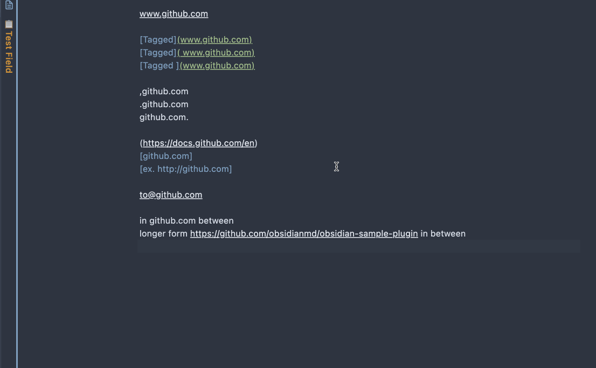

# Obsidian URL Namer

An Obsidian plugin that converts plain URLs in selected text into Markdown links using each page's title.

## What's New in v1.1.0

Thanks to [mvexel](https://github.com/mvexel) for contributing these improvements:

- Modernized TypeScript code
- Added option to auto-name URLs on paste (enable in Settings -> URL Namer)
- Added offline detection with graceful fallback
- Improved title extraction (supports `og:title`, `twitter:title`)
- Updated build tooling

## Usage

1. Select text that contains one or more plain URLs.
2. Run the command `Name the URL links in the selected text`.

Notes:
- Process a small batch of URLs at a time for best reliability.
- While the command is running, do not edit or reselect the text.
- URLs that are already inside Markdown links (for example `[label](https://example.com)`) are skipped.
- Optional: enable **Settings -> URL Namer -> Auto-name links on paste** to convert pasted plain-text URLs automatically.
- If Obsidian is offline, the plugin keeps links unchanged and shows a single notice.

## Development

- `npm install`: install dependencies.
- `npm run dev`: build in watch mode.
- `npm run build`: run TypeScript checks and create a production bundle (`main.js`).
- `npm run lint`: run ESLint.
- `npm run smoke:title -- https://example.com`: quickly test title extraction for a URL.

## Installation

### From source (manual)

1. Build the plugin with `npm run build`.
2. Create (or open) your vault plugin folder:
   `VaultFolder/.obsidian/plugins/url-namer/`

> Use **Vault switcher -> Manage vaults** to see the exact local vault path.

3. Copy these files into that folder:
   - `main.js`
   - `manifest.json`
   - `styles.css` (if present)
4. In Obsidian, open **Settings -> Community plugins**, refresh, and enable **URL Namer**.

## Customization

The URL-matching regex is currently hard-coded in `main.ts` as `UrlTagger.rawUrlPattern`.

Title extraction defaults to the HTML `<title>` tag. For sites that rely on custom metadata, site-specific parsing may be required (for example the existing WeChat `og:title` handling).

## Known Limitations

- Some websites block requests or return non-HTML content.
- JavaScript-rendered pages may not expose a useful title in the initial response.
- The plugin currently has no user settings for regex or per-site parsing rules.

## Future Development

- Move URL regex configuration into plugin settings.
- Add configurable site-specific title extraction rules.
